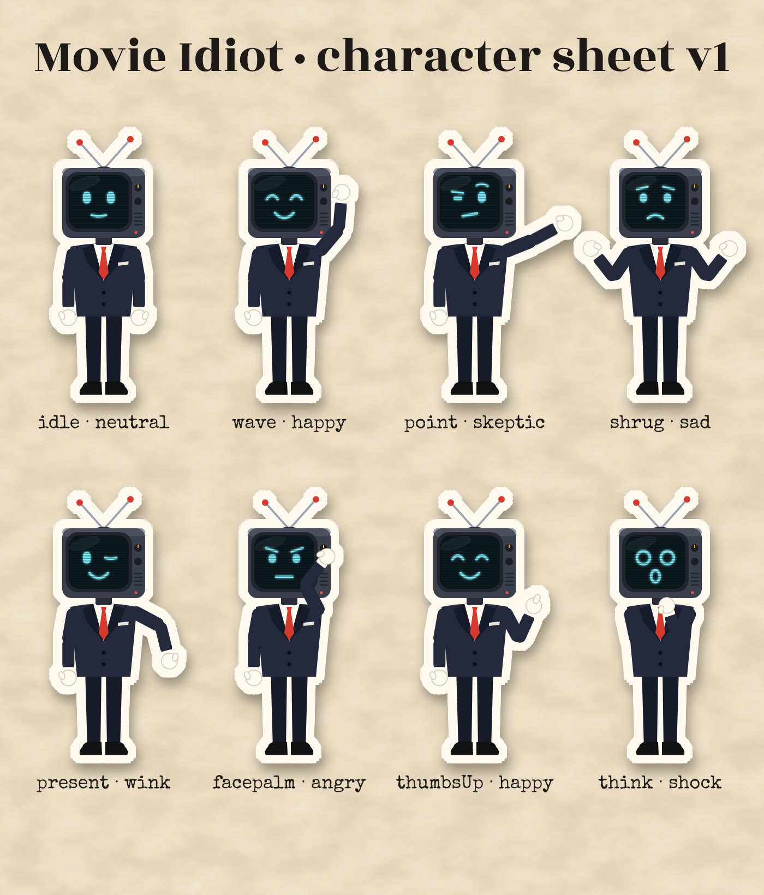

# Collage Shorts: experimental production path

For the full system design and roadmap, see [system-outline.md](system-outline.md). Renders and upload packages are written to `projects/shorts/SLUG/` (git-ignored); the status table is in [shorts-ideas.md](shorts-ideas.md).

This document describes an **illustrated Shorts prototype**, not an approved change to the channel's style. The user's stated goal remains movie reviews and full revisits, and the merged Phalke Short has not received creative approval. For those reviews and mashups, make an edit from actual footage/selects and use graphics as support. The Phalke prototype is all original vectors: it does not exercise web-image procurement, use film footage, or establish that any future soundtrack/assets are free of rights claims.

Prototype: **`phalke`**, a researched story about *Raja Harishchandra* (1913). Its current hook says “India's first feature film”; that wording needs qualification because some histories cite *Shree Pundalik* (1912) earlier. Do not reuse the existing headline as a public claim without revising the script. Original vector artwork says nothing by itself about audio rights or future assets, and YouTube's automated copyright scan is not legal clearance.

## How it is built

| Layer | File | What it does |
|---|---|---|
| Timing | `src/collage/timeline.ts` | Script lines → start/duration/word cues. Estimated until a real voice exists; recordings and speech-service word cues replace the estimate and the whole edit re-times. `clock()` gives frame lookups: `c.line('hook1')`, `c.word('hook1', 'आदमी')`, `c.end('pea1')`. |
| Motion library | `src/collage/primitives.tsx` | Paper, Grain, Cutout (white paper border + shadow around any alpha shape or PNG), Enter (pop/drop/rise/left/right/swing/flip), Float, Jitter (stop-motion on twos), Shake, Camera + Layer (parallax), TornLabel, Stamp, Marker, Draw (self-drawing arrows/routes), Counter, WordDrop, TornWipe, Sfx, Captions (word-highlighted). |
| Art | `src/collage/art.tsx` | Original vector cut-outs: figures, necklace, cinema screen/audience/beam, crown/bow/feather, pot + stepped pea plant, film strip, ship, hand-cranked camera, dev tray, reel, cooking pot, coin, lotus medal, sunburst. |
| Theme | `src/collage/theme.ts` | Palette and self-hosted fonts (`public/fonts`, SIL OFL): Rozha One display, Mukta body/captions/stamps, Kalam handwriting, Special Elite typewriter. |
| A short | `src/collage/shorts/<slug>/` | `script.ts` (lines, title, sources) and the edit component. Register it in `src/collage/shorts/index.ts`. |
| Sound | `scripts/sfx_kit.py` | Original synthesized kit: whoosh, pop, stamp, shutter, coin, riser, paper, projector flicker, tanpura + Bhupali bed. Generated into `public/sfx` (git-ignored) on first render. |
| Music | `scripts/import_music.py`, `public/music/` | Original beds from the owner's music-mania repo (`D:\cash-grabs\music-maker`, renders in its R2 bucket: `node tools/assets.mjs pull out/<name>.mp3`). The script cuts the most energetic 70 s, fades it and matches the old bed's loudness (-16.5 LUFS). A Short picks one with `export const music = 'mass-entry'`; `youtube.txt` then gets the sample-library credit (Salamander piano is CC BY 3.0). Tracks: city-lights (lo-fi), mass-entry (South action), neon-bhairav (Indian fusion), golden-hour, spring-dream (uplifting), sandhya (Hindi ballad), pahadi-winter (raga Pahadi). |
| CLI | `scripts/short.ts` | `npm run short -- list | timing | voice | stills | render | package`. |

Every frame value comes from `useCurrentFrame()`, `spring`, `interpolate` or Remotion's seeded `random()`, so renders are deterministic.

## Workflow

```bash
npm ci
python -m venv .venv && .venv/bin/pip install numpy edge-tts   # sound kit + optional online voice
npm run short -- stills phalke --every 1        # contact sheets → projects/shorts/phalke/sheet-*.jpg
npm run short -- render phalke --draft          # 540×960 draft → projects/shorts/phalke/draft.mp4
npm run short -- render phalke                  # 1080×1920 final → projects/shorts/phalke/video.mp4
npm run short -- speed phalke                   # upload copy, 8% faster → projects/shorts/phalke/video-fast8.mp4
npm run studio:shorts                           # Remotion Studio for timeline scrubbing
```

On Linux the CLI uses `/opt/pw-browsers/.../headless_shell` when present. Set `REMOTION_BROWSER` to point elsewhere.

### Adding the voice

Recommended: **record it yourself**. That is the strongest "this is not mass-produced" signal under YouTube's inauthentic-content policy, and it is the channel's personality.

1. Record each script line as its own file, named by line ID: `public/shorts/phalke/voice/hook1.wav`, `hook2.wav`, … (`.wav`, `.mp3`, `.m4a` or `.ogg`). A phone voice-memo app in a quiet room is fine. Leave ~0.2 s of silence at each end.
2. `npm run short -- timing phalke` measures every file and writes `public/shorts/phalke/timing.json`. Missing lines keep estimated timing.
3. Render. All cuts, stamps and pops move to the real delivery. Within a line, word anchors are spread by word length. For exact word cues, add `<lineId>.words.json` (`[{text,start,end}]`, e.g. from WhisperX) next to the recording.

Alternative: `npm run short -- voice phalke --edge` synthesizes each line with Microsoft's online Hindi voice and saves real word boundaries. This sends the script to Microsoft and needs `speech.platform.bing.com` to be reachable.

## Making the next short

Pitch backlog and written scripts: [shorts-ideas.md](shorts-ideas.md). Ten fun-facts scripts live in `src/collage/shorts/<slug>/script.ts` with labelled stills in `public/shorts/<slug>/stills/`. Human picks the slug to narrate next.

1. Pick a story with a twist that can be told in ~45–60 s and whose visuals you can own (illustrate it, use public-domain or licensed images).
2. Write `script.ts`: one breath per line, spoken Hinglish, a hook that lands in the first 3 seconds, a loop line that echoes the hook. Every claim needs a source in `sources`.
3. Plan one beat per idea. Each beat changes something visually every 1–2 s: an entrance, a stamp, a camera push, a marker. Anchor events to words, not seconds.
4. Reuse primitives; add art to `art.tsx` only when the library lacks it. When a move recurs, promote it into `primitives.tsx`.
5. `stills` → read the contact sheets → fix → `render --draft` → watch → final.

### Review checklist (fail the draft if any is true)

- Anything static for more than ~2 s, or a beat that opens on an empty frame.
- Text wrapping unexpectedly, overlapping a cut-out, or sitting in the bottom ~380 px / right-edge Shorts UI zone.
- Devanagari conjuncts broken (check stamps and display text; Rozha One lacks some, such as श्च).
- On-screen text that only repeats the caption instead of adding a joke, label or number.
- A claim without a source, or a quote that was never said.
- A line that reads like a telegram, a bare English verb ("directed"), or a real person spoken of in the singular when respect is due (see "Script and design review").
- A still tag whose film/year does not match the photo itself.

## Fun-facts format ("Did you know?")

Format for the next Shorts. Starter: `src/collage/shorts/fun-facts-template/` (placeholder text, not facts). Copy it, replace lines, sources and plan, register it in `src/collage/shorts/index.ts`.

### Script structure

Every line has a `role`. `npm run short -- lint SLUG` checks the rules below. `render` stops on lint errors unless you pass `--force`.

| Role | Length | Job |
|---|---|---|
| `hook` | ≤ 10 words, ~3 s | Most surprising fact as a specific claim or question (name, number, year). Withhold one detail. No greeting, no channel name. On screen from the first frame. |
| `setup` ×1 | 5–8 s | One fact of context that makes the hook matter. Never contains the answer (lint flags payoff names/numbers seen this early). |
| `tension` ×1–3 | 5–8 s each | The obstacle that keeps the question open, with a turn word: पर / लेकिन / फिर भी / मना / नहीं. Every line moves toward the answer; side facts (box office, a tangent) are cut. |
| `fact` | 5–9 s | Legacy role; counts as a fact beat. Setup + tension + fact = 3–5 beats, each with `source`. |
| `promise` | — | Deprecated (lint warns). It gave the answer away at ~3 s in Wasseypur and Mughal-e-Azam. |
| `reveal` (optional) | short | Punch line right after its fact beat; the headline swaps. |
| `payoff` | short | Answers the exact hook question, in the last 3–5 s. Its still racks into focus. |
| `loop` | short | Repeats the hook's key word. The hook frame returns, so the restart reads as one shot. |
| `cta` (optional) | very short | Only after the loop. Prefer pinned comment/description. |

**Hook → Setup → Tension → Payoff.** One question, answered last. Matched against Studio "stayed to watch" (Oct 2026): Sholay (57%), Interval (55%) and Nana Patekar (53%) follow it; Wasseypur (38%) leaked the answer in the promise, and Mughal-e-Azam (38%) and Coolie (32%) drifted off the question in the middle. Sources: [Subscribr](https://subscribr.ai/p/scripting-youtube-shorts-engagement), [OutlierKit](https://outlierkit.com/resources/youtube-script-template/), [SocialK](https://socialk.it/en/blog/tiktok-storytelling-guide) (practitioner guides, not controlled data).

Target 28–36 s total (lint warns over 36). The voice starts 0.1 s in (`LEAD_IN` in `src/collage/timeline.ts`). Picture changes every 2–4 s; new beat every 5–9 s. On-screen headlines add a label, name or number; they never repeat the caption.

Basis (marketing-blog heuristics, checked October 2026, not platform data): most Shorts drop-off happens in the first 3 s; open loops and callback endings help replays; YouTube counts loops as views. [OpusClip](https://www.opus.pro/blog/ideal-youtube-shorts-length-format-retention), [virvid looping](https://virvid.ai/blog/looping-structure-shorts-retention-2026). Check them against the channel's own retention graphs after a few uploads.

### Language: Hinglish, not textbook Hindi

Write the way you would tell a friend. English for film words, reactions and anything people say in English (director, villain, box office, "seriously", "Fact one", years). Hindi for the glue. "इस film का villain actually किसी और का था?", not "इस चलचित्र के खलनायक की भूमिका…". Lint flags textbook words (निर्देशक, दर्शक, पुरस्कार, किंतु, वर्ष, तथ्य …) with the everyday word to use.

### Audio directions (`delivery`)

Each line can carry `delivery` on top of its role default (`src/delivery.ts`):

| Field | Effect |
|---|---|
| `mood` | neutral, excited, curious, serious, punch, hushed, deadpan, warm. Edge: rate/pitch/volume. ElevenLabs: stability (style/speed are ignored by v4), plus an audio tag ([excited], [curious], [serious], [dramatic] …) on `eleven_v3`/`eleven_v4` models. Windows: rate only. |
| `rate`, `pitch` | Extra % / Hz on top of the mood. Keep changes small; big jumps sound robotic. |
| `pause`, `hold` | Seconds of silence before / after the line, placed on the timeline so cuts and music play into it. |
| `music` | `duck` (default), `drop` (music out through the pause, voice lands in silence, music returns 1.5 s in), `swell` (music sits up under the line). |
| `sfx` | `[{word, sound, volume}]`: an effect on a spoken word (`pop.wav`, `stamp.wav`, `whoosh.wav`, `riser.wav`, `shutter.wav`, `coin.wav`, `paper.wav`, `flicker.wav`). |
| `emotion` | ElevenLabs v3/v4 audio tag for the whole line (`'surprised'`, `'conspiratorial'`, `'playful'` …). Overrides the mood's tag. |
| `cues` | `[{word, tag}]`: an audio tag placed just before a spoken word, e.g. `{word: 'बिना', tag: 'surprised'}`. Tags never reach captions. |

Role defaults: hook excited; promise curious; reveal punch with a 0.25 s pause; payoff serious with a 0.45 s pause (no music drop by default; `music: 'drop'` now dips the bed to 35% instead of cutting it); loop curious with music swell; cta warm. `npm run short -- say SLUG` prints each line's direction next to its spoken text. Render re-measures timing every time, so direction changes re-time the edit. With word cues, a recorded line ends 0.15 s after its last word (TTS files carry ~0.9 s of trailing silence), and the picture holds 0.5 s after the final word (`TAIL`), so the loop runs straight into the restart.

### Voice: Devanagari for the speech engine

Hindi voices read Devanagari reliably and guess at Latin-script words ("Madhu" came out wrong in the college draft). `src/speech.ts` converts each line before any voice provider (Windows, Edge, ElevenLabs; also `narrate_project` for long-form):

- Shared `LEXICON` for loanwords and common names (college → कॉलेज, Madhu → मधु), per-short `lexicon` in `script.ts`, or a full-line `say` override.
- Years and dates are spoken in English, in pairs: 1988 → नाइनटीन एटी एट, 1905 → नाइनटीन ओ फ़ाइव, 2024 → ट्वेंटी ट्वेंटी फ़ोर, "3 मई" / "May 3" → थर्ड मे, 1990s → नाइनटीन नाइंटीज़. Counts and amounts stay Hindi (15 रुपये → पंद्रह रुपये).
- Captions and `clock().word()` anchors still use the display `text`. Speech-service word cues are mapped back to display words; raw spoken cues stay in `voice/<id>.spoken.json`.

Run `npm run short -- say SLUG` before voicing. Any `[guessing: …]` word needs a lexicon entry or `say`.

### Film stills

Owner decision: this channel is transformative commentary, so images may be used when credited. Three kinds are allowed:

- **Creative Commons / public domain** (for example Wikimedia Commons). Record the licence, the attribution text and the licence URL. Follow the licence terms, such as share-alike or attribution wording.
- **Publicity stills, posters and portraits** (copyrighted). Used under fair dealing for criticism and review; not a licence, and a rights holder can still file a claim. Record them as copyrighted and credit them in the video description. Credits do not go on screen, because on-screen credit text hurts the look of the video.
- **Film video and audio** have stricter licensing and are where YouTube's copyright systems focus most. They need explicit authorization or a licence that allows this use. Images do not extend to them.

Rules:

- Download with `npm run short -- still SLUG --url IMAGE --source PAGE --credit "Studio" --label "Film (Year): what it shows" --name f1`. It saves to `public/shorts/SLUG/stills/` and records source, credit and rights in `stills.json`.
- Verify film and year on the source page. For CC images, check the licence on the file page and keep the attribution text. Show the still only while its line plays, with the film/year tag and credit (`FilmStill` does both). Add the stills ledger to the description.
- The commentary is the content: never a stills slideshow, never full-frame Ken Burns.

### Clean look (`src/collage/clean.tsx`)

Two weights of one family (Mukta 800/500), smooth springs with no overshoot, text revealed from a baseline, dark backdrop with a slow glow, film stills as mounted prints with a slow push, marigold accent. `ShortShell captionStyle="clean"` uses `CleanCaptions`: 2–3 words on a soft dark pill, active word in marigold, no heavy outline, so Devanagari matras stay crisp. The paper-collage primitives still work inside a fun-facts beat when a joke needs a cut-out or stamp.

Plan options for a livelier beat (`src/collage/formats/FunFactsShort.tsx`):

| Option | Effect |
|---|---|
| `still.width`, `still.aspect`, `still.push` | Print size, crop ratio and slow-push range. Prints of ~860–980 px fill the frame; a small print over empty space looks unfinished. |
| `hook.blur` | Default 0. Channel rule: the hook (first) image is always sharp, so don't blur it. |
| `cuts: [{word, line?, src, …, offset?, tilt?, replace?}]` | Another print drops in when `word` is spoken. `replace: true` takes the previous print away; otherwise it stacks. Use it so a 7–9 s beat changes picture every 2–4 s. |
| `pop: {word, line?, text}` | Short stamp (number, label) on a spoken word. |

Prints hold until the next beat starts, so a directed pause never shows an empty frame.

#### Whiteboard (experiment)

VideoScribe-style hand-drawn boards (`src/whiteboard/`, test bench `whiteboard-demo`): see [whiteboard.md](whiteboard.md).

#### Design v2 (`design: 'v2'`, `src/collage/formats/v2.tsx`)

New Shorts use v2 ([redesign plan](shorts-redesign.md)); v1 Shorts render unchanged. v2 drops the "1/3" counters and the "Answer" kicker, puts headlines top-left with accent words boxed, boxes the spoken caption word, and rotates beat entries (whip, TV static, slide, cut).

| Plan field | Effect |
|---|---|
| `palette` | `marquee` (dark, gold), `velvet` (red curtain), `newsprint` (paper, red), `lagoon` (teal, coral), or custom colours. Vary it between uploads. |
| `layout` per fact | `print`, `stack` (with `cuts`), `number` (`number: {word, value, suffix, label}`, counts up on its word; the print shrinks under it), `versus` (`versus: {top, bottom, middle}`), `ticket` (`ticket: {word, title, figure, sub}`). No two beats in a row share a layout. |
| `react` on hook/fact/payoff | Movie Idiot cameo, top-right, on a spoken word: `{word, expression, pose}`. Max 3 per Short; reacts only, never talks. Set `export const tribute = true` on tributes and tragedies: lint flags any cameo. |
| `transition` per fact | Override the rotation: `whip`, `static`, `slide`, `cut`. |

Pick anchor words early in the line for `number` and `ticket`; a figure that lands in the last second barely registers.

### Script and design review

`/review-short SLUG` (`.claude/commands/review-short.md`) is the full review. `npm run short -- lint SLUG` automates part of it:

- **Grammar.** A fact, reveal or promise line with 3+ Hindi words and no Hindi verb is flagged as a telegram ("Maratha Light Infantry के साथ तीन साल training."). A bare English past tense ending a clause ("खुद directed.") should become stem + helper ("direct की").
- **Honorific.** `export const honorific = true` in `script.ts` flags singular verbs (गया, था, रहा, करता …) for a Short about a real person who should be spoken of respectfully.
- **Stills ledger.** Every plan still must be in `stills.json` (error). A tag year that is missing from the ledger label is flagged, so check the photo's own date.
- **Static beats.** A beat of more than ~6 s with one still and no `cuts`, `pop` or `reveal` is flagged.

Lint cannot hear the line. Still read every line aloud for collocations ("सूखे farmers" means dry farmers), ambiguity and tone, and open every contact sheet.

## Finishing in FilmCraft, stings in EffectCraft (optional)

On a machine with the Storyteller apps installed (`C:\Program Files\FilmCraft`, `C:\Program Files\EffectCraft`), a rendered Short can get a finishing pass. First used on `12th-fail`.

```bash
npm run short -- render SLUG                                   # Remotion base: projects/shorts/SLUG/video.mp4
"C:/Program Files/EffectCraft/effectcraft-cli.exe" --empty script scripts/effectcraft/sting.jsx --save-as projects/shorts/SLUG/fx/sting.ecproj
"C:/Program Files/EffectCraft/effectcraft-cli.exe" --project projects/shorts/SLUG/fx/sting.ecproj render --comp sting --out projects/shorts/SLUG/fx/sting.mov --format prores --prores 4444 --channels rgba --audio off
node scripts/filmcraft/finish-short.mjs SLUG --sting fx/sting.mov --sting-line payoff --sting-word 50 --shake "f2:पहले,f3:कमाई"
npm run short -- speed SLUG --percent 15 --from video-filmcraft  # upload copy: video-filmcraft-fast15.mp4
```

- `scripts/effectcraft/sting.jsx`: After Effects-style script for a transparent 1.5 s number sting (glowing text, double shockwave). Edit `STING` at the top (text, colour, y). Drop the Remotion `pop` on that word so the two don't double up.
- `scripts/filmcraft/finish-short.mjs`: drives FilmCraft's MCP server headless. V1 the render with its audio; V2 the sting on its word; V3 a full-length grade (Lumetri contrast and saturation, vignette, fine grain); V4 a 0.4 s light-leak flash on every beat cut; V5 an RGB-split hit on the hook and camera shake on the `--shake` words. Exports `video-filmcraft.mp4` (H.264, -14 LUFS) and saves `SLUG.fcproj` for hand edits in FilmCraft.
- Keep effects subtle: the first pass at light-leak intensity 70 washed the whole frame out; 30 reads as a warm flash.
- Channel intro (1920×1080, 7 s): `scripts/effectcraft/channel-intro.jsx` builds two shots (projector beam with dust and the mascot; the MOVIE IDIOTS wordmark slam with sparks, shockwaves, a light sweep and the tagline). Render `shotA`/`shotB` to ProRes into `projects/intro/`, then `node scripts/filmcraft/channel-intro.mjs` cuts them with a TV-power transition, grades, shakes the slams, mixes the sfx kit and exports `projects/intro/movie-idiots-intro.mp4`. `scripts/filmcraft/client.mjs` is the shared FilmCraft MCP client.
- The MCP servers are registered per machine (`claude mcp add --scope local filmcraft -- "C:\Program Files\FilmCraft\filmcraft-cli.exe" mcp`), not in `.mcp.json`.

## Known gaps / next steps

- **Voice**: none yet in this environment (no reachable TTS). Record lines as above.
- **Photo cut-outs**: `Cutout` already works on transparent PNGs; add a `rembg`/BiRefNet step to cut real public-domain photos (for example Phalke portraits) when the network allows model downloads.
- **Timeline JSON**: shorts are hand-written TSX for now. Once 2–3 shorts exist, extract the repeated beat patterns into a JSON timeline that an agent can edit.
- **Long form**: 16:9 compositions, chapter structure and B-roll pacing for 7–8 minute videos, built on the same primitives.

## Mascot: "Movie Idiot" (TV-head presenter)

The suited TV-head figure is the channel's own avatar; the channel owns the character. `src/collage/characters/` turns it into a reusable vector rig that renders sharp at any size.



### Use it in any video

```tsx
import {Presenter} from '../../characters';

<Presenter
  at="bottom-left"            // 'bottom-left' | 'bottom-right' | 'center' | {x, y}; bottom anchors sit just above the caption band
  width={290}
  enter={ready - 18}          // local frame of the beat when it pops in (exit={…} pops it out)
  talk={false}                // true + timing={timing} timeOffset={from}: mouth flaps on narration words
  cues={[
    {at: ready - 18, expression: 'skeptic'},
    {at: stamps[1], pose: 'shrug', expression: 'sad'},
    {at: no + 6, expression: 'angry'},
    {at: 90, screen: 'static'},  // or any React node shown on the TV screen
  ]}
/>
```

- **Poses:** idle, wave, point, shrug, present, facepalm, thumbsUp, think (spring-blended between cues).
- **Expressions:** neutral, happy, shock, skeptic, wink, sad, angry. Blinking, breathing, sway, antenna wobble and screen flicker are automatic.
- **Lower level:** `TVHead` takes explicit `pose`, `expression`, `mouth` and `screen`; `usePose` and `useMouth` drive them.
- **In the prototype:** shrugs at the "नहीं" stamps (casting beat), shock then facepalm on the loop reveal.

Use it as a reactor and host, not on every beat: one or two cameos per Short; host segments in long form.

### Brand images

`npm run brand` regenerates transparent 2400×4000 PNGs in `public/brand/` (wave, idle, point, shrug, facepalm, thumbs-up) and `docs/mascot-sheet.jpg`. Use them for thumbnails, channel art and community posts. Other previews: `npx tsx scripts/still.ts mascot-still out.png --scale 4 --props '{"pose":"point","expression":"skeptic"}'`, and the 9 s motion test `mascot-demo` (`npx remotion render src/collage/index.tsx mascot-demo out.mp4`).

v1 was drawn from the avatar's description; match colours and details to the original avatar image when it can be loaded here.
